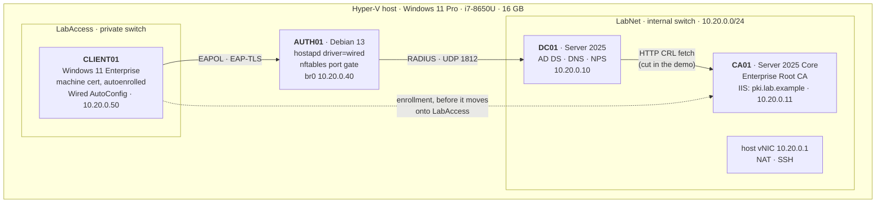
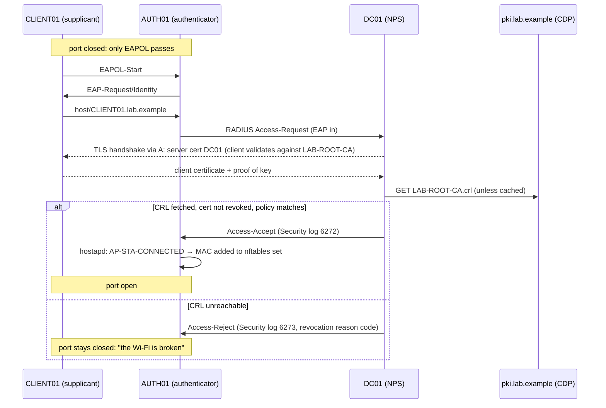

# EAP-TLS lab: certificate-based 802.1X, rebuilt in Hyper-V

A reproducible, scripted miniature of an enterprise 802.1X / EAP-TLS rollout: an Active
Directory domain, an enterprise CA that hands out machine certificates through Group Policy
autoenrollment, NPS as the RADIUS server with an EAP-TLS network policy, and a Windows 11
client that gets onto the network by proving it holds its certificate. No passwords, no
pre-shared keys.

It exists because the production version of this work cannot be shown. Everything here is
built from scratch on lab-only names (`lab.example`, `LAB-ROOT-CA`, RFC 2606 `.example`
domains). No employer configuration, client names or production data appear anywhere in it.

The centrepiece is a failure demo. The lesson the production rollout taught was that an
unreachable CRL distribution point (CDP) breaks authentication in a way that looks like a
radio problem. The lab reproduces that on demand: the client, the certificate, the CA and
the "switch" stay exactly as they were, the RADIUS server loses its route to the CDP, and
NPS starts rejecting a certificate it accepted a minute earlier, with the Security-log event
and reason code that say why.

**Status:** scripts written, linted and template-checked on 2026-10-26; Hyper-V enabled on
the build laptop 2026-11-11. The first end-to-end run is next, and [`RUNLOG.md`](RUNLOG.md)
records each stage as it runs.

## Architecture



Where the revocation check happens, which is the whole point of the demo:



The client never fetches the CRL that decides its fate. When the decision is made it is on
a closed port with no network at all. The fetch that matters is the RADIUS server's.

## How the lab maps to the production design

| Production (from the portfolio entry) | Lab |
| --- | --- |
| ADCS certificate autoenrollment via GPO | Enterprise Root CA on CA01; `LabComputerAuth` template (duplicate of Workstation Authentication, Autoenroll for Domain Computers); GPO `LAB - Certificate Autoenrollment` with `AEPolicy=7` linked at the domain root |
| NPS/RADIUS on Azure-hosted domain controllers | NPS on DC01, the domain controller |
| WPA2-Enterprise Wi-Fi, 30 sites | One wired 802.1X port (see below) |
| CRL/CDP reachability validated across split-VPN topologies | HTTP-only CDP on its own name, `pki.lab.example`; `demo/Test-LabCdpReachability.ps1` runs `certutil -verify -urlfetch` from the RADIUS server; the demo cuts the route the way a split tunnel would |

## Design decisions

**Wired, not Wi-Fi.** There is no RADIUS-capable access point on this desk, and Hyper-V has
no virtual Wi-Fi. EAP-TLS is the same EAP method over either medium: same certificates, same
NPS policy logic, same revocation check. What changes is the transport (EAPOL on a wired port
instead of EAPOL over 802.11 association) and one policy condition: NAS-Port-Type is
Ethernet (15) here, where Wi-Fi would be Wireless - IEEE 802.11 (19).

**A Linux VM as the switch port.** A Hyper-V virtual switch has no 802.1X port
authentication of its own. AUTH01 plays the switch: hostapd with the `wired` driver relays
EAPOL from the client's port to NPS over RADIUS and never decides anything itself
(`eap_server=0`). hostapd's wired driver does not block or open anything (its driver ops
have no station-authorize hook), so the port gate is explicit: a bridge-family nftables set
of authorized MACs, filled and emptied by a `hostapd_cli -a` action script on
`AP-STA-CONNECTED` / `AP-STA-DISCONNECTED`. Until NPS says yes, the client's frames go
nowhere. hostapd labels requests as 802.11 by default, so `radius_auth_req_attr=61:d:15`
makes it send NAS-Port-Type Ethernet like a real switch.

**eapol_test as the fallback, not the plan.** Nothing documents whether a Hyper-V private
switch forwards frames addressed to the 802.1X group address `01:80:C2:00:00:03` from one VM
to another. `demo/Test-LabEapolPath.ps1` settles that with tcpdump on the first run. If the
switch drops them, `demo/Invoke-LabEapolTest.ps1` runs the same EAP-TLS conversation against
NPS from AUTH01 with `eapol_test`, presenting CLIENT01's own certificate and key. NPS applies
the same policy and the same revocation check and logs the same events; only the Windows
supplicant and the EAPOL hop drop out. The full wired path is preferred because it shows the
real client-side symptom: a Windows machine with a valid certificate and no network.

**NPS on the DC, with Desktop Experience.** NPS (the NPAS role) is not available on Server
Core, so DC01 is the one VM with a desktop. Keeping NPS on the DC mirrors the production
layout; CA01 stays on Core.

**NPS policy by export/import.** The EAP-TLS settings of an NPS network policy are an
undocumented binary attribute, and the NPS PowerShell module has no network-policy cmdlets.
The policy is built once in `nps.msc` ([docs/nps-policy-gui.md](docs/nps-policy-gui.md)),
captured with `Export-NpsConfiguration` into a template with the build-specific values
(server-certificate thumbprint, RADIUS secret, RADIUS client address, domain SID) swapped for
tokens, and imported with `Import-NpsConfiguration` on every build after that. RADIUS client
creation, server-certificate enrollment and auditing are scripted outright.

**HTTP-only CDP on its own name.** By default ADCS stamps certificates with an LDAP CDP
first. A domain controller can always reach LDAP on itself, which would hide the failure.
CA01 advertises a single HTTP CDP and AIA on `pki.lab.example`, a CNAME, so the CDP can be
made unreachable independently of AD, and could move without reissuing certificates.

**Shortcuts that are lab-only.** A one-tier CA (production PKIs put an offline root above an
issuing CA; the CDP behaviour is the same). The client template marks keys exportable so the
eapol_test path can reuse CLIENT01's identity. Machine keys in production should not be
exportable.

## Resource budget

| VM | OS | RAM (dynamic, startup / max) | Disk |
| --- | --- | --- | --- |
| DC01 | Windows Server 2025 Standard eval, Desktop Experience | 2 / 3 GB | 40 GB differencing |
| CA01 | Windows Server 2025 Standard eval, Core | 1.5 / 2 GB | 40 GB differencing |
| CLIENT01 | Windows 11 Enterprise eval, vTPM | 4 / 4 GB | 64 GB differencing |
| AUTH01 | Debian 13 generic cloud image | 0.5 GB static | 8 GB |

Peak about 9.5 GB for VMs, leaving the host roughly 6 GB on a 16 GB laptop. Windows VMs sit
on differencing disks over one base per image, so three Windows VMs cost roughly two
applied images of disk.

## Media

| File (save in `C:\Lab\iso\` under this name) | Source | Size |
| --- | --- | --- |
| `WindowsServer2025-Eval.iso` | [Evaluation Center: Windows Server 2025](https://www.microsoft.com/en-us/evalcenter/download-windows-server-2025) (registration form; 180-day eval) | 8,152,356,864 bytes |
| `Windows11-Enterprise-Eval.iso` | [Evaluation Center: Windows 11 Enterprise](https://www.microsoft.com/en-us/evalcenter/download-windows-11-enterprise) (registration form; 90-day eval) | 8,225,329,152 bytes |
| `debian-13-generic-amd64.tar.xz` | [cloud.debian.org: trixie/latest](https://cloud.debian.org/images/cloud/trixie/latest/), checked against `SHA512SUMS` | 322,982,872 bytes (build 20261111-2659) |

Windows sizes are the download headers observed on 2026-10-26; Microsoft refreshes eval ISOs, so
expect drift. The two Windows ISOs sit behind a registration form, so they are downloaded
by hand. No product keys are needed.

## Running it

```powershell
# 0. Once, elevated, then reboot. Changes a system feature, so it is never run for you.
.\host\Enable-HyperV.ps1

# 1. Anywhere, any time: parse + PSScriptAnalyzer + bash -n, and render every template.
.\tools\Invoke-LabLint.ps1
.\tools\Test-LabTemplates.ps1

# 2. Elevated, with the media in C:\Lab\iso. Every stage is idempotent.
.\Build-Lab.ps1
```

The first build stops at the `Nps` stage with a message pointing at
[docs/nps-policy-gui.md](docs/nps-policy-gui.md): build the policy once in `nps.msc`, then

```powershell
.\Build-Lab.ps1 -Stage NpsCapture, Nps, Client, Authenticator, Attach
```

and commit `roles/dc01/nps/nps-config.template.xml`. Later builds run straight through.

Then the demo:

```powershell
.\demo\Invoke-LabDemo.ps1                      # wired path
.\demo\Invoke-LabDemo.ps1 -Method EapolTest    # if Test-LabEapolPath says the switch drops EAPOL
```

| Phase | What changes | Expected evidence |
| --- | --- | --- |
| Baseline | CDP reachable, CRL caches cleared | NPS 6272 (granted); client pings DC01 |
| Break | Outbound block DC01 → `pki.lab.example:80`; caches cleared | NPS 6273 (denied) with a revocation reason code; client has no network |
| Prove | `certutil -verify -urlfetch` on DC01 against CLIENT01's certificate | CDP fetch fails; revocation offline (`CRYPT_E_REVOCATION_OFFLINE`) |
| Restore | Block removed; caches cleared | NPS 6272 again |

Microsoft's NPS reason-code table lists 258 ("NPS cannot access the certificate revocation
list") and 259 ("The certification authority that manages the certificate revocation list is
not available") for this situation. Which one, and the exact `Reason` text current builds
log, is recorded in the run log from the actual events.

Why the caches are cleared every phase: NPS keeps a CRL until its NextUpdate. Without the
purge, the block would change nothing for up to a week, and then authentication would start
failing with nothing obviously changed. The demo collapses that delay so cause and effect
sit side by side. `demo/Clear-LabCrlCache.ps1` purges the URL cache as SYSTEM (NPS's
identity, not the administrator's), resyncs the chain engine, and restarts NPS.

Every phase writes JSON and text evidence to `C:\Lab\eaptls\out\`.

## Layout

```
Build-Lab.ps1            orchestrator: stages, idempotent
lab.config.psd1          every name, address, size and template name
host/                    Hyper-V side: network, base disks, VMs, shared helpers
  unattend/              answer files injected into each VM disk
roles/
  common/                static IP, domain join
  dc01/                  forest, directory objects, autoenrollment GPO, NPS
  ca01/                  enterprise CA + CDP/AIA, IIS, certificate templates
  client01/              certificate check + wired 802.1X profile
  auth01/                cloud-init seed, hostapd, nftables gate, systemd units
demo/                    evidence collection, the CDP failure demo, eapol_test path
docs/                    the one-time NPS policy step
tools/                   lint and template checks
site-note/               draft write-up for the portfolio site's Notes section
PORTFOLIO.md             draft update to the portfolio entry
RUNLOG.md                what happened when it ran
```

## Secrets

Generated on first use, never typed, never committed: the Administrator/DSRM/client
passwords, the RADIUS shared secret and the PFX password live as DPAPI-protected
`Export-Clixml` files in `C:\Lab\eaptls\secrets\`, readable only by the account that built
the lab. `.gitignore` refuses keys, PFX, PEM, VHDX and ISO files. `Export-NpsConfiguration`
writes RADIUS secrets in clear text, so every export is sanitized to tokens before it leaves
DC01.

## Not yet proven (the first run settles each)

- Whether the Hyper-V private switch delivers EAPOL VM-to-VM (`Test-LabEapolPath.ps1`).
- That cloud-init picks the NoCloud seed on a local Hyper-V VM rather than probing for Azure.
- The LAN profile XML against what Windows 11 itself exports (`netsh lan export profile`).
- The ADSI template duplication against a template duplicated in the MMC.
- How the Windows supplicant treats an unreachable CRL for the *server* certificate. The demo
  does not depend on it; Microsoft does not document it.

## Tearing it down

```powershell
'CLIENT01','AUTH01','CA01','DC01' | ForEach-Object { Stop-VM $_ -TurnOff -Force; Remove-VM $_ -Force }
Remove-VMSwitch LabNet, LabAccess -Force
Remove-NetNat LabNat -Confirm:$false
Remove-Item C:\Lab\eaptls -Recurse -Force   # VM disks, secrets, evidence
```
